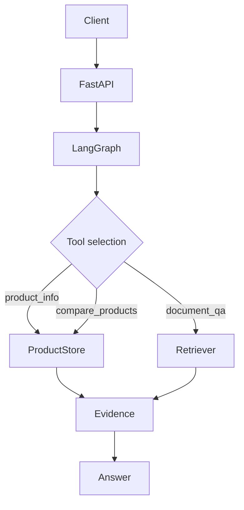

# Architecture / 架构与真实范围

- `route`: offline rule-based router, or **optional** LLM function tool_calls planner.
- `product_info`: read synthetic products or authorized FinDataHub API.
- `document_qa`: FAISS IP index + normalized vectors + *product scoped* retrieval.
- `render`: offline evidence output; or LLM grounded generation + source list.
- LangGraph `InMemorySaver` maintains active product across thread turns. **Memory is volatile**, not long-term.
- No payments, personal financial advice, real customer data, accounts, trading, or broker integration.

## Technical boundaries

1. Rule-based offline mode is a deterministic workflow; it is not an autonomous planning LLM.
2. Hash embedding is an **offline token-gram vector demo**, not a semantic encoder; sentence mode downloads a public encoder.
3. Optional LLM tool_calls work only with providers that implement OpenAI-compatible tools; confirm provider support.
4. `thread_id` is user-supplied without auth, so bind demo to localhost. Add auth, authorization and durable checkpoint before production exposure.
5. Demo RAG returns retrieved citations but has no source-claim alignment validator and may include low-relevance retrieval.
6. `docs/` and `data/` are public **synthetic** content and do not contain corporate code.
